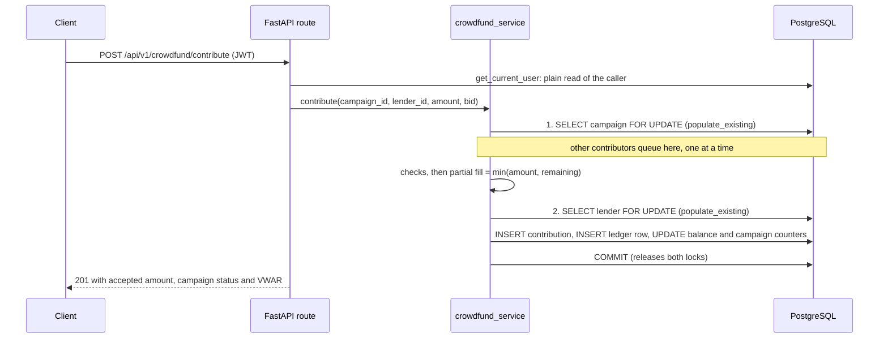

# Architecture (v0.2-alpha)

## Contribute: one transaction, fixed lock order

## Lock hierarchy

1. The parent row first (a campaign; later also a social loan).
2. Then user rows, in ascending `user_id` when more than one is needed.

Every money transaction follows this order, so two transactions can never wait on each
other in a cycle.

## Invariants (checked in tests by `ledger_service.find_invariant_violations`)

- I1: for every user, `balance == 100.00 + SUM(ledger amounts)`
- I2: `SUM(balances) + SUM(held contributions) == 100.00 * number of users`
- I3: each campaign's `current_raised` and `weighted_yield_sum` equal the sums over its
  contributions

## Not built yet

Campaign acceptance and refunds, the spending-friction domain, 1-on-1 loans, idempotency keys,
rate limiting, metrics and deployment. 
